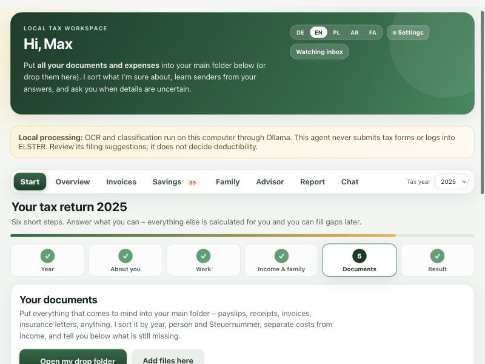
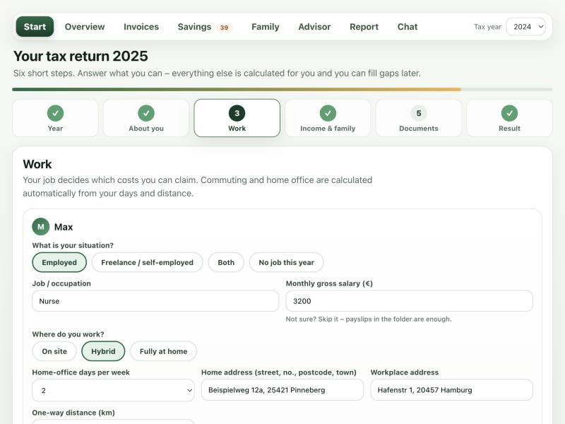
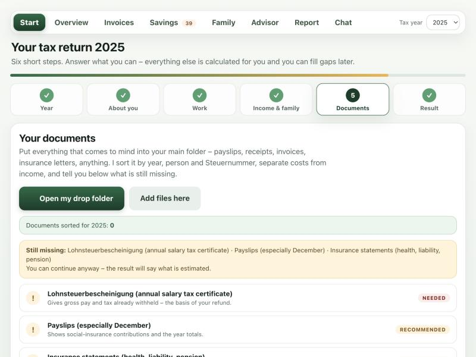
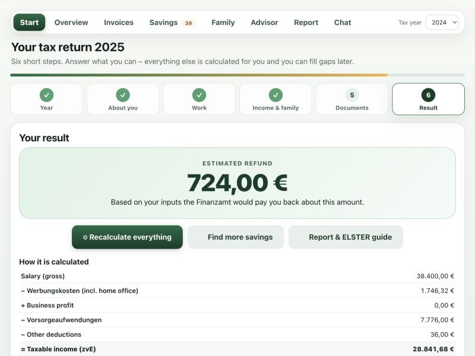

# Steuer-Assistant – Download

A **local-first** assistant for your German tax documents. It sorts your receipts and payslips into a tax folder on **your own computer**, asks about deductions step by step, estimates your refund and prepares a report for your Steuerberater.

* Your documents never leave your computer.
* It **never** logs in to ELSTER, stores a certificate or sends anything to a Finanzamt. You submit yourself.
* Languages: Deutsch · English · Polski · العربية · فارسی (Dari)

> The figures are an indicative estimate, not tax advice or a tax assessment.

## Screenshots

*Fictional demo data only. Your real documents never leave your computer.*

| Guided start | Work, home office, commute |
|---|---|
|  |  |
| **What is still missing** | **Estimated refund** |
|  |  |

## How it works

1. **Pick the tax year** – with the filing deadline.
2. **About you** – drop a Finanzamt letter; names, Steuernummer and tax office are read automatically (on your computer).
3. **Work** – job, on site / hybrid / home office, home and work address. The commute distance and days are calculated (optional online distance lookup only after you agree).
4. **Income and family** – salary, freelance income, children, church tax.
5. **Documents** – put everything into one folder. It is sorted, costs and income are separated, and you see what is missing.
6. **Result** – your estimated refund with a step-by-step calculation, a report for your Steuerberater and an ELSTER guide.

Nothing to provide? One click calculates every standard deduction automatically. Nothing is invented – more real receipts can raise the estimate.

Privacy: the app listens on `127.0.0.1` only, has no telemetry and never logs in to ELSTER. Estimates work for tax years 2024, 2025 and 2026.

## Download

**Website:** https://romal10.github.io/steuer-assistant-download/

Pick your system (direct download):

| System | File |
|---|---|
| Windows 10/11 | [Steuer-Assistant-Windows.zip](https://github.com/romal10/steuer-assistant-download/releases/latest/download/Steuer-Assistant-Windows.zip) |
| Mac with Apple chip (M1–M4) | [Steuer-Assistant-Mac-AppleSilicon.zip](https://github.com/romal10/steuer-assistant-download/releases/latest/download/Steuer-Assistant-Mac-AppleSilicon.zip) |
| Mac with Intel chip | [Steuer-Assistant-Mac-Intel.zip](https://github.com/romal10/steuer-assistant-download/releases/latest/download/Steuer-Assistant-Mac-Intel.zip) |

## Installation (first start) – Anleitung

### Windows
1. Download the ZIP, **right-click ▸ Extract all…** (Alle extrahieren).
2. Open the folder `Steuer-Assistant` and double-click **`Steuer-Assistant.exe`**.
3. If Windows shows *"Windows protected your PC"*: click **More info ▸ Run anyway** (the app is not code-signed yet).
4. A black window opens – **keep it open** (it watches for new files). Your browser opens at `http://127.0.0.1:8766`.

### Mac
1. Download the ZIP and double-click it – a folder `Steuer-Assistant` appears. Move it to *Applications* or *Documents*.
2. Open **Terminal**, type `xattr -dr com.apple.quarantine ` (with a space at the end), drag the folder into the window, press **Return**. This removes the "unidentified developer" block (the app is not code-signed yet).
3. Double-click **`Steuer-Assistant`** inside the folder (or drag it into Terminal and press Return).
4. Keep the window open. Your browser opens at `http://127.0.0.1:8766`.

### First-run setup in the app
1. **Click "Get started"** – choose where your tax folder is created (default: *Documents ▸ Steuerverwaltung*).
2. **Enter the people** in your household and choose your **Bundesland** and **Finanzamt** from the dropdowns.
3. **Drop your documents** (payslips, receipts, letters) into the *Inbox* folder or onto the page. The app sorts them.
4. Open **Savings ▸ ▶ Guide me step by step**: for every deduction you get a suggested amount (from your Bundesland, payslips or documents) – press **Use this amount**, **Enter my own amount** or **Not needed**.
5. Open **Report** to print/save the report for your Steuerberater, and **Overview ▸ Guided ELSTER help** when you file.

Updating: download the new ZIP and replace the old folder – your tax folder and settings stay untouched.

## Licence
MIT – see [LICENSE](LICENSE). This repository only contains the ready-to-run program and instructions.
